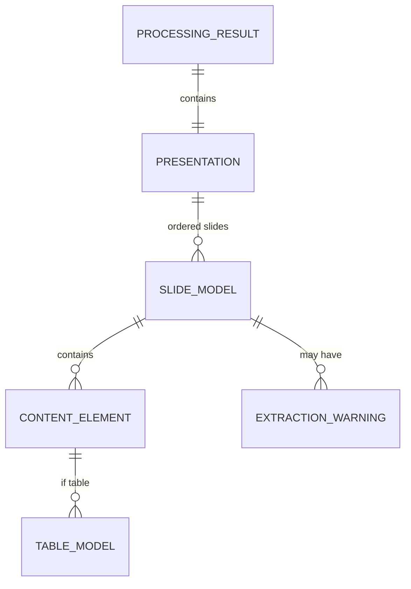

# Technical Specification Document (TSD)

> **Status:** LOCKED  
> **Source Spec:** `PRD.md` (Gate 2 In-Progress)  
> **Target Release:** MVP  
> **Architect / Lead:** AI Agent + Human Gatekeeper

---

## 1. System Overview & Technical Objectives

### 1.1 Summary

Web app SPA 100% browser-local. Upload `.pptx` → validasi → unzip via JSZip → parse XML via `DOMParser` → Normalized Slide Model → render Markdown → preview/copy/download. Zero server, zero network request saat processing.

### 1.2 Core Architectural Principles

- **Pattern:** Modular pipeline (Validator → Parser Adapter → Renderer) dipisah dari UI (React).
- **State Management:** React `useReducer` lokal, tanpa library eksternal.
- **Execution Model:** Synchronous async/await di main thread; Web Worker hanya jika profiling menunjukkan blocking >100ms.

---

## 2. Technology Stack & Dependencies

| Layer                  | Technology Choice    | Justification              | Strict Version Constraint |
| :--------------------- | :------------------- | :------------------------- | :------------------------ |
| **Runtime / Language** | TypeScript (browser) | Type safety, LSP           | TS ^5.3, target ES2020    |
| **Build Tool**         | Vite                 | Fast dev, optimal bundle   | Vite ^5.0                 |
| **Framework**          | React                | Component model, hooks     | React ^18.3               |
| **Styling**            | Tailwind CSS         | Utility-first, minimal CSS | Tailwind ^3.4             |
| **PPTX Unzip**         | JSZip                | Mature, zero-dep unzip     | JSZip ^3.10.1             |
| **XML Parsing**        | Native `DOMParser`   | Zero bundle cost, standard | Browser API               |
| **Testing**            | Vitest               | Vite-native, cepat         | Vitest ^1.0               |

> **Dependency Boundary Rule:** Dilarang menginstal library di luar tabel ini tanpa update TSD + approval manusia (lihat `RULES.md` §1).

---

## 3. Data Models & Schemas

### 3.1 Core Data Structure (ERD logis)



### 3.2 Canonical TypeScript Schemas (sumber kebenaran: `src/lib/parser/types.ts`)

```typescript
export interface SlideModel {
  slideNumber: number;
  title: string | null;
  content: ContentElement[];
  notes: string | null;
  warnings: ExtractionWarning[];
}

export type ContentElement =
  | { type: "paragraph"; text: string }
  | { type: "bullet"; level: number; text: string }
  | { type: "table"; headers: string[] | null; rows: string[][] }
  | {
      type: "unsupported";
      elementType: UnsupportedElementType;
      message: string;
    };

export type UnsupportedElementType =
  | "image"
  | "chart"
  | "diagram"
  | "video"
  | "embedded-object"
  | "smartart"
  | "math";

export interface ExtractionWarning {
  slideNumber: number;
  elementType: UnsupportedElementType;
  message: string;
}

export interface Presentation {
  title: string; // dari metadata docProps/core.xml, fallback: nama file
  slides: SlideModel[];
}

export interface ProcessingResult {
  success: boolean;
  data?: {
    markdown: string;
    warnings: ExtractionWarning[];
    slideCount: number;
  };
  error?: { code: ErrorCode; message: string };
}

export type ErrorCode =
  | "INVALID_TYPE"
  | "FILE_TOO_LARGE"
  | "CORRUPTED_FILE"
  | "NO_SLIDES"
  | "PARSE_FAILURE";
```

---

## 4. Interface Contracts

### 4.1 Modul Validator (`src/lib/validator/file-validator.ts`)

- **Input:** `file: File`
- **Output:** `Result<{ file: File }, { code: ErrorCode; message: string }>`
- **Rules:** ekstensi `.pptx`, MIME OOXML presentation, ukuran ≤ 25MB.

### 4.2 Modul Parser Adapter (`src/lib/parser/pptx-adapter.ts`)

- **Input:** `file: File`
- **Output:** `Promise<Result<Presentation, ParseError>>`
- **Kontrak:** TIDAK pernah throw; semua failure jadi `Result.error` atau warning per elemen.

### 4.3 Modul Renderer (`src/lib/renderer/markdown-renderer.ts`)

- **Input:** `Presentation`
- **Output:** `string` (Markdown) — deterministic, selalu sukses.
- **Format:** `# Judul` → `## Slide NN — Judul` → konten → `> ⚠️` warnings → `> **Catatan pembicara:**` notes → `---` pemisah.

### 4.4 Orkestrator Hook (`src/hooks/useFileProcessor.ts`)

- **State machine:** `idle → processing → success | error`
- **Kontrak:** satu file per eksekusi; hasil reset saat file baru diupload.

### 4.5 Tidak ada API/HTTP contract — semua lokal. Tidak ada persistence.

---

## 5. Security, Boundaries & Error Handling

### 5.1 Error Handling & Resilience

- **Fail-explicit per elemen:** konten gagal diekstrak → `ContentElement.unsupported` + warning; TIDAK pernah silent skip (FR8, PRD).
- **Fail-fast pada boundary:** file invalid → reject sebelum parsing.
- **Tidak ada retry:** parsing lokal deterministic; retry tidak relevan.

### 5.2 Security Boundaries

- **Sandbox:** semua di browser; zero network call saat processing; tidak ada eval/Function().
- **Input validation:** tipe MIME + ekstensi + ukuran (defense in depth).
- **Secrets:** tidak ada (zero backend, zero API key).
- **Privasi:** file tidak pernah keluar dari perangkat; dinyatakan eksplisit di UI (PRD FR/NFR).

---

## 6. Implementation Traceability Matrix

| PRD Feature ID    | Technical Component / File Target                                      | Test Strategy                         |
| :---------------- | :--------------------------------------------------------------------- | :------------------------------------ |
| F1 (FR1, FR2)     | `src/lib/validator/file-validator.ts`, `src/components/FileUpload.tsx` | Unit + component test                 |
| F2, F3 (FR3–FR5)  | `src/lib/parser/text-extractor.ts`, `pptx-adapter.ts`                  | Unit test fixture XML                 |
| F4 (FR6)          | `src/lib/parser/table-extractor.ts`                                    | Unit test (merged cells, empty cells) |
| F5, F8 (FR8, FR9) | `ContentElement.unsupported` + `WarningList.tsx`                       | Unit test warning generation          |
| F6                | `pptx-adapter.ts` error paths (`CORRUPTED_FILE`, `NO_SLIDES`)          | Unit test corrupted fixture           |
| F7                | `src/components/PreviewPane.tsx`                                       | Component test                        |
| F9                | `src/components/ExportButtons.tsx` (Blob + `URL.createObjectURL`)      | Component test                        |
| F10 (FR10)        | `src/lib/parser/notes-extractor.ts`                                    | Unit test notes fixture               |
| F11               | `src/components/Layout.tsx` (halaman keterbatasan)                     | Manual review                         |
| FR7 (angka)       | Renderer passthrough (no transform)                                    | Unit test `237,6 kWp` fidelity        |
| NFR Performa      | `pptx-adapter.ts`                                                      | Benchmark test (opsional, P1)         |

---

## 7. Gate 2 Technical Verification Sign-Off

- [x] Arsitektur konsisten dengan batasan PRD (browser-local, tanpa AI, tanpa backend)
- [x] Skema data dan kontrak modul terdefinisi deterministik
- [x] Tidak ada dependensi di luar daftar (`react`, `jszip` + dev tooling)
- [x] **Technical Sign-off by:** [Human Architect] on [Date] ← Tunggu konfirmasi manusia sebelum eksekusi TASK.md
